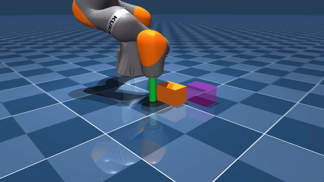
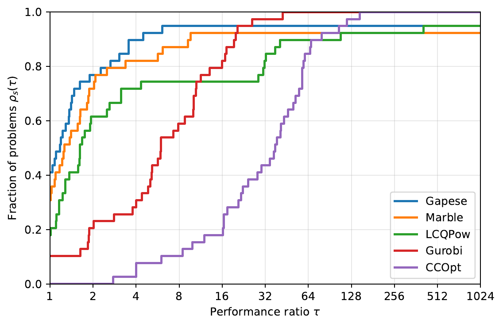

# Gapese

Gapese (GAp PEnalty SEmismooth) is a C++ solver for complementarity-constrained quadratic programming (CCQP), based on a D-gap penalty reformulation and a semismooth Newton-type method.

The solver provides Python and MATLAB interfaces and is designed for efficient solution of structured CCQPs.

## Problem formulation

Gapese solves CCQPs of the form

$$
\begin{aligned}
\min_{x,\lambda,\eta}\quad & \frac{1}{2}x^\top Q_x x + r_x^\top x + \frac{1}{2}\lambda^\top Q_\lambda \lambda + r_\lambda^\top \lambda + \frac{1}{2}\eta^\top Q_\eta \eta + r_\eta^\top \eta \\
\text{s.t.}\quad & A_x x + A_\lambda \lambda + A_\eta \eta - b = 0, \\
& C_x x + C_\lambda \lambda + C_\eta \eta - d \ge 0, \\
& 0 \le \lambda \perp \eta \ge 0.
\end{aligned}
$$

where $x \in \mathbb{R}^{n_x}$ and $\lambda,\eta \in \mathbb{R}^{n_\lambda}$.

## Features

- **Structure-exploiting reformulation** — D-gap penalty reformulation for complementarity constraints, revealing exploitable sparsity and convexity structure inherent in CCQP.
- **Semismooth Newton-type algorithm** — with fast local convergence, structure-exploiting Hessian modification, merit line search globalization, non-interior-point inequality constraint handling, and warm-start support.
- **Efficient implementation and interfaces** — C++17/Eigen sparse solver core with Python and MATLAB interfaces.

## Installation

### Python

From the repository root:

```bash
python -m pip install .
```

For development and tests:

```bash
python -m pip install -e ".[test]"
```

### C++

Requirements: a C++17 compiler, CMake 3.18+, and Eigen 3.4.

```bash
cmake -S . -B build -DCMAKE_BUILD_TYPE=Release
cmake --build build --config Release
cmake --install build --config Release --prefix /path/to/gapese-install
```

An installed Gapese package can be used from another CMake project with

```cmake
find_package(gapese CONFIG REQUIRED)
target_link_libraries(my_program PRIVATE gapese::gapese)
```

If Eigen is not available as an installed CMake package, provide its header directory explicitly:

```bash
cmake -S . -B build -DEIGEN3_INCLUDE_DIR=/path/to/eigen-3.4.0 -DGAPESE_FETCH_DEPENDENCIES=OFF
```

### MATLAB

Compile the MEX interface from MATLAB by providing the Eigen include directory:

```matlab
cd("path/to/gapese-cpp/matlab")
build_gapese_mex("path/to/eigen-3.4.0")
```

## Quick start

Minimal examples are provided for all supported interfaces:

- [C++](examples/cpp/simple_ccqp.cpp)
- [Python](examples/python/simple_ccqp.py)
- [MATLAB](examples/matlab/simple_ccqp.m)

## Robotics application

- [gapese-mujoco](https://github.com/KY-Lin22/gapese-mujoco) — a robotics application of Gapese using MuJoCo.



## Benchmark

Gapese is evaluated on a fixed 39-problem MacMPEC-derived CCQP benchmark against Marble, LCQPow, Gurobi, and CCOpt. See [gapese-benchmark](https://github.com/KY-Lin22/gapese-benchmark) for the benchmark protocol, solver configurations, and reproducible results.



## Documentation

- **K. Lin** and T. Ohtsuka, "[A Gap Penalty Method for Optimal Control of Linear Complementarity Systems](https://doi.org/10.1109/CDC56724.2024.10885989)," *Proceedings of the 63rd IEEE Conference on Decision and Control (CDC)*, pp. 880–887, Dec. 2024.
- **K. Lin** and T. Ohtsuka, "[A Gap Penalty Reformulation for Mathematical Programming With Complementarity Constraints: Convergence Analysis](https://doi.org/10.1109/LCSYS.2025.3579405)," *IEEE Control Systems Letters*, Vol. 9, pp. 925–930, Jun. 2025.

Detailed algorithm and interface documentation will be added under `docs/`.

## License

Gapese is released under the [BSD 3-Clause License](LICENSE).
